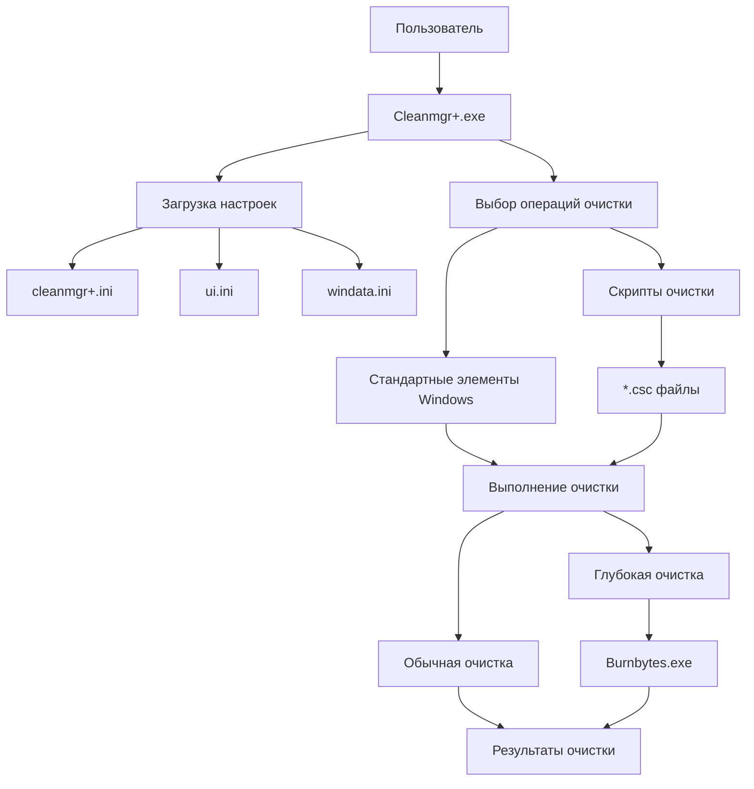

# Документация проекта Cleanmgr+

## 1. Структура проекта

```
Clean/
  - bin/
    - cleanmgr+.ini
    - packages/
      - cleanmgr/
        - Burnbytes.exe
        - de/
          - Burnbytes.resources.dll
      - cmp-app.ico
      - cmp-refresh-dark.png
      - cmp-refresh.png
      - ui.ini
    - winapp.ini
    - windata.ini
  - Cleanmgr+.exe
  - scripts/
    - #Rules.txt
    - Google Chrome Cache.csc
    - Google Chrome History.csc
    - Microsoft Edge Cache.csc
    - Mozilla Firefox Cache.csc
    - Opera Cache.csc
    - Vivaldi Cache.csc
    - Waterfox Cache.csc
    - Windows Defender.csc
    - Windows Downloads.csc
    - Windows Error Reporting.csc
    - Windows Event Viewer Logs.csc
    - Windows Font Cache.csc
    - Windows Icon Cache.csc
    - Windows Installer Cache.csc
    - Windows Logs.csc
    - Windows MUICache.csc
    - Windows Remote Desktop Cache.csc
    - Windows Shadow Copies.csc
    - Windows Sidebar Cache.csc
    - Windows Update Logs.csc
```

## 2. Описание файлов

### Cleanmgr+.exe
- **Назначение**: Основной исполняемый файл программы, улучшенная версия стандартной утилиты "Очистка диска" Windows.
- **Ключевые функции**: Запуск интерфейса программы, выполнение операций очистки системы.
- **Связи с другими файлами**: Использует конфигурационные файлы из директории bin/ и скрипты из директории scripts/.
- **Краткое объяснение логики**: Предоставляет пользовательский интерфейс для выбора и выполнения различных операций очистки системы.

### bin/cleanmgr+.ini
- **Назначение**: Основной конфигурационный файл программы.
- **Ключевые функции**: Хранит настройки программы, параметры запуска и состояние интерфейса.
- **Связи с другими файлами**: Используется основным исполняемым файлом для загрузки настроек.
- **Краткое объяснение логики**: Содержит секции [RunOnce], [Settings], [Items] и [WindowState] для хранения различных параметров программы.

### bin/winapp.ini
- **Назначение**: Файл для пользовательских настроек очистки.
- **Ключевые функции**: Позволяет добавлять пользовательские файлы, директории и ключи реестра для очистки.
- **Связи с другими файлами**: Используется основной программой при выполнении пользовательских операций очистки.
- **Краткое объяснение логики**: Позволяет пользователям указывать дополнительные элементы для очистки, поддерживает переменные, шаблоны и сокращенные форматы ключей реестра.

### bin/windata.ini
- **Назначение**: Содержит описания стандартных элементов очистки Windows.
- **Ключевые функции**: Предоставляет информацию о различных элементах очистки, их назначении и рекомендации.
- **Связи с другими файлами**: Используется для отображения информации пользователю в интерфейсе программы.
- **Краткое объяснение логики**: Структурирован по секциям с подробными описаниями каждого элемента очистки и рекомендациями по их использованию.

### bin/packages/ui.ini
- **Назначение**: Конфигурация пользовательского интерфейса программы.
- **Ключевые функции**: Определяет цветовые схемы и темы интерфейса.
- **Связи с другими файлами**: Используется для настройки внешнего вида программы.
- **Краткое объяснение логики**: Содержит различные темы оформления (Light, Dark, Teal, Iris и т.д.) с определением цветов для различных элементов интерфейса.

### bin/packages/cleanmgr/Burnbytes.exe
- **Назначение**: Вспомогательная утилита для глубокой очистки системы.
- **Ключевые функции**: Выполняет низкоуровневые операции очистки.
- **Связи с другими файлами**: Вызывается основной программой для специфических операций очистки.
- **Краткое объяснение логики**: Обеспечивает более глубокую очистку системы, чем стандартные средства Windows.

### scripts/#Rules.txt
- **Назначение**: Документация по скриптовому движку программы.
- **Ключевые функции**: Описывает синтаксис и возможности скриптов очистки.
- **Связи с другими файлами**: Служит справочником для создания и понимания скриптов в директории scripts/.
- **Краткое объяснение логики**: Содержит информацию о поддерживаемых секциях, командах и параметрах скриптов.

### scripts/*.csc файлы
- **Назначение**: Скрипты для очистки различных компонентов системы и приложений.
- **Ключевые функции**: Определяют последовательность действий для очистки конкретных приложений или компонентов Windows.
- **Связи с другими файлами**: Используются основной программой при выполнении соответствующих операций очистки.
- **Краткое объяснение логики**: Каждый скрипт содержит секции [Info] с метаданными и [Files] с командами для выполнения очистки.

## 3. Архитектура проекта

### Общая структура
Cleanmgr+ имеет модульную архитектуру, состоящую из основного исполняемого файла, конфигурационных файлов и скриптов очистки. Программа разделяет функциональность между основным приложением и скриптами, что обеспечивает гибкость и расширяемость.

### Потоки данных
1. Пользователь взаимодействует с графическим интерфейсом Cleanmgr+.exe
2. Программа загружает настройки из конфигурационных файлов (cleanmgr+.ini, ui.ini)
3. При выборе операций очистки программа обращается к соответствующим скриптам (.csc файлы)
4. Скрипты выполняют последовательность команд для очистки системы
5. При необходимости для специфических операций вызывается Burnbytes.exe

### Mermaid-схема



## 4. Библиотеки/фреймворки

### Windows Forms
- **Назначение**: Создание графического интерфейса пользователя
- **Где используется**: В основном приложении Cleanmgr+.exe для отображения элементов управления и интерфейса

### .NET Framework
- **Назначение**: Среда выполнения для приложения
- **Где используется**: Основа для всего приложения и его компонентов

## 5. Точка входа и запуск

### Как запускается проект
Проект запускается через исполняемый файл Cleanmgr+.exe, который можно запустить как обычное приложение Windows. При запуске программа может требовать повышенных прав администратора для выполнения некоторых операций очистки.

### Что выполняется первым
1. Загрузка конфигурационных файлов (cleanmgr+.ini, ui.ini)
2. Инициализация пользовательского интерфейса согласно настройкам
3. Сканирование доступных скриптов очистки в директории scripts/
4. Отображение главного окна программы с доступными операциями очистки

## 6. Архитектурные особенности

### Нестандартные решения
1. **Скриптовый движок**: Программа использует собственный скриптовый движок для определения операций очистки, что делает её легко расширяемой.
2. **Модульность**: Разделение функциональности между основным приложением и скриптами позволяет легко добавлять новые возможности без изменения основного кода.
3. **Интеграция с системными утилитами**: Программа может использовать стандартную утилиту очистки диска Windows (Cleanmgr.exe) в дополнение к собственным возможностям.

### Причины выбора архитектуры
1. **Гибкость и расширяемость**: Скриптовый подход позволяет легко добавлять новые операции очистки без изменения основного кода.
2. **Безопасность**: Использование собственных ресурсов Windows и избегание потенциально опасных действий.
3. **Удобство для пользователя**: Современный интерфейс с возможностью настройки внешнего вида и функциональности.
4. **Совместимость**: Поддержка различных версий Windows (Windows 10/11, 32/64-бит).

Подпись относится к текущей версии проекта.

---

Автор: legenda  
Telegram: [@LEGENDA_SD](https://t.me/LEGENDA_SD)
